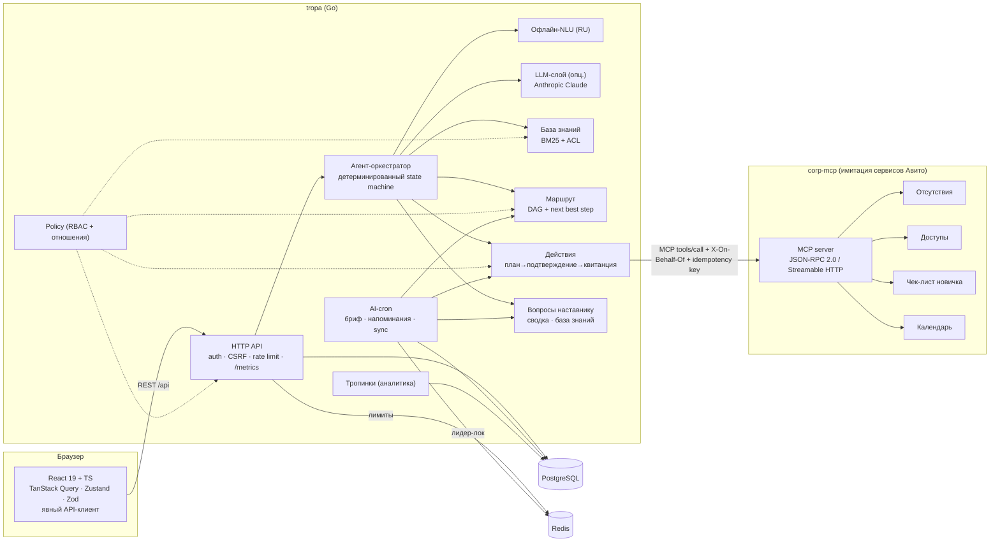

# Архитектура «Тропы»

## Почему так
| Решение | Обоснование |
|---|---|
| **Детерминированный оркестратор, LLM — только язык** | HR-действия должны быть предсказуемыми и проверяемыми. Права, переходы и вызовы сервисов — в коде; модель извлекает интент/слоты (structured outputs), формулирует ответ строго по источникам, оценивает teach-back. Любой сбой модели → офлайн-ответ (`llm_fallback`). |
| **Офлайн-режим по умолчанию** | Эксперты могут проверить все сценарии без ключа; деградация модели не ломает продукт. |
| **MCP для корпоративных сервисов** | В Авито есть платформа ИИ-агентов с MCP — коннекторы подключаются заменой URL. Инструменты помечены `readOnlyHint`; всё, что меняет данные, требует подтверждения пользователя. |
| **Делегированная идентичность** | Тропа вызывает сервис от имени пользователя (`X-On-Behalf-Of`, в проде — OAuth 2.0 Token Exchange, RFC 8693), сервис сам проверяет права: даже ошибка агента не позволит согласовать собственную заявку. |
| **ACL до ранжирования** | Документ, недоступный роли/команде, не участвует в поиске и не попадает в промпт → нет утечек через LLM. |
| **Exactly-once** | Атомарный `UPDATE … WHERE status='planned'` + ключ идемпотентности → двойной клик/ретрай не создаёт дублей; ретраи транспорта безопасны. |
| **Circuit breaker + timeouts** | Сбой корпоративного сервиса не вешает UI: действие → `failed` с понятным текстом и кнопкой «Повторить». |
| **Контент как код** | Команда сама поддерживает свой «пак» (контакты, календарь, инструкции, маршрут) в Git; валидация при старте и в CI. |
| **Один бинарник + отдельный corp-mcp** | Просто деплоить (UI встроен через `go:embed`), но граница интеграции явная и тестируемая. |

## Соответствие стеку и инфраструктуре Авито
| Что есть в Авито | Как используется |
|---|---|
| Go, PostgreSQL, Redis | Бэкенд на Go 1.26, pgx, go-redis |
| React, TypeScript, TanStack, Zustand, Zod | UI именно на этом стеке; Zod валидирует каждый ответ API |
| Данные сотрудников, авторизация, ролевая модель | `internal/directory` и `internal/auth` — тонкие адаптеры-имитации; в проде заменяются SSO (OIDC) и API оргструктуры без изменений в агенте |
| Аналитика событий / Clickstream, Kafka | События в clickstream-совместимом формате (`user, team, role, name, props, ts`); сейчас — PostgreSQL (outbox), в проде — публикация в Kafka |
| ИИ-агенты, промпты, MCP | Корпоративные системы — MCP-инструменты; промпты версионируются в `internal/llm/prompts.go` |
| ИИ-крон | `internal/cron`: идемпотентные задачи (таблица `cron_runs`), лидер через Redis-лок |
| Feature flags (runtime/compile-time) | Runtime-флаги с переопределением на команду (`internal/flags`); compile-time — дефолты в коде (`flags.Defs`), демо-эндпоинты отключаются `DEMO_MODE=false` |
| Docker, Grafana, CI/CD | Docker Compose, `/metrics` (Prometheus → Grafana), GitHub Actions (vet, тесты, покрытие, сборка образа) |

## Права (ролевая модель + отношения)
| Действие | Стажёр | Наставник | Руководитель | HR BP |
|---|---|---|---|---|
| Свой маршрут, чат, заявки | ✔ | — | — | — |
| Маршрут стажёра | только свой | подопечных | своей команды | всех |
| Отметить пункт | свои ручные | свои пункты у подопечных | свои пункты + наставника | — |
| Согласовать отгул/доступ | ✖ | ✖ | своей команды (не себя) | ✖ |
| Сводка вопросов | ✖ | адресованные ему | команды | ✖ |
| Тропинки | ✖ | ✖ | своя команда | все |
| Флаги | ✖ | ✖ | команды | глобальные |
| Документы | public + своей команды | + restricted для наставников | + restricted | все |
| Доступ prod-db | ✖ (запрещено ролью) | по согласованию | по согласованию | — |

## Поток «Как оформить отгул?» (путь от запроса до результата)
1. Стажёр: «Оформи отгул на 13 ноября». NLU (или LLM) → `absence/do`, дата.
2. Проверки: флаг сценария, правила (не в прошлом, ≤ 3 дней, не выходные), календарь команды через MCP `calendar_team_events` → предупреждение «Демо спринта».
3. План (`actions.status=planned`) — карточка: что уйдёт в сервис, кто согласует, кого уведомим, права.
4. «Отправить заявку» → атомарно `planned→executing` → MCP `absence_create_request` (on-behalf-of, idempotency key = id плана).
5. Квитанция `ABS-00001`, статус «на согласовании», уведомления наставнику (к сведению) и руководителю (на согласование).
6. Руководитель согласует во вкладке «Согласования» → MCP `absence_decide` от его имени → статус и уведомление стажёру; крон синхронизирует статусы, если решение принято в сервисе напрямую.

## Масштабирование и эксплуатация
- Stateless API (сессия — подписанный JWT), горизонтально масштабируется; крон — один лидер (Redis lock).
- Метрики: `tropa_http_requests_total`, `tropa_http_request_seconds`, `tropa_chat_turns_total{intent,mode}`.
- Health: `/healthz` (жив), `/readyz` (БД, MCP, Redis).
- После онбординга Тропа остаётся точкой входа для рабочих вопросов: те же канал и база знаний, маршрут скрывается.

## Развитие
Каналы (мессенджер-бот поверх того же API), подключение реальных MCP-коннекторов (отсутствия, доступы, чек-лист),
векторный поиск поверх BM25 (гибрид), авто-предложения правок командного пака из «Тропинок», сценарии для HR BP (экватор, выпускной).
